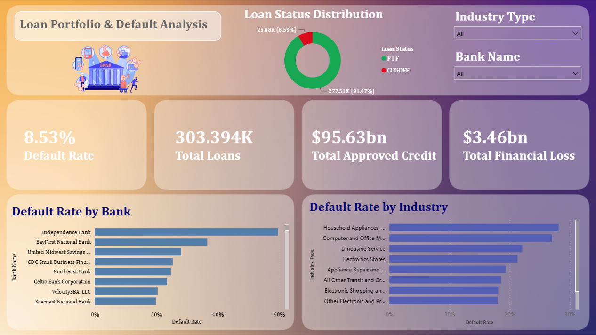

# Commercial Credit Risk Analytics: SBA Loan Default Analysis

## 1. Executive Summary
This project analyzes historical Small Business Administration (SBA) commercial loans to identify patterns of credit risk and default. By evaluating borrower profiles, loan terms, and industry sectors, this analysis provides data-driven recommendations to strengthen underwriting processes, optimize loan portfolios, and minimize financial exposure to charged-off loans. 

The project demonstrates an end-to-end data analytics pipeline: from raw data extraction and robust structural cleaning in SQL Server to a minimalist, interactive executive dashboard in Power BI.

## 2. Business Problem
Financial institutions face significant capital risk when issuing commercial loans. While the SBA guarantees a portion of these loans, banks still absorb substantial losses when businesses default (`Charged Off`). The objective of this project is to build an analytical framework that answers critical business questions:
- Which industry sectors (NAICS) present the highest default risks?
- How does loan duration (`TermInMonths`) correlate with repayment success?
- Which lending institutions exhibit systemic weaknesses in their underwriting approvals?
- What are the highest-risk industries at a localized, state level?

## 3. Data Source
- **Dataset:** U.S. SBA Loan Data (2010–2019).
- **Target Variable:** `LoanStatus` (Paid In Full vs. Charged Off).

## 4. Methodology & Data Architecture
- **Data Engineering & Sequential Filtering (SQL):** Extracted, cleaned, and transformed raw governmental data using T-SQL. A reusable View (`vw_clean_loan_data`) was created to ensure statistical significance by employing **Sequential Filtering**:
    1. Isolated major commercial banks (lenders with >500 loans) using Window Functions (`COUNT OVER PARTITION BY`).
    2. Recalculated industry volumes *strictly within* that filtered banking cohort, eliminating industries with <100 loans to remove statistical noise.
    3. Handled missing values (`COALESCE`) and performed structural data type casting.
- **Exploratory Data Analysis (SQL):** Aggregated default rates by industry, geography, and loan term using Common Table Expressions (CTEs) and Window Functions (`RANK() OVER`).
- **Data Visualization (Power BI):** Developed an interactive, minimalist Credit Risk Dashboard enabling risk managers to filter exposure metrics dynamically. Incorporated conditional formatting and custom formatting for financial data.

## 5. SQL Query Portfolio
The `SQL_Scripts` folder contains the core analytical queries driving this project:
- `01_data.sql`: The foundational View performing data cleaning and sequential filtering.
- `02_default_rate_by_industry.sql`: Risk analysis identifying the most volatile business sectors.
- `03_risk_by_loan_term.sql`: Duration analysis segmenting loans into risk buckets.
- `04_bank_underwriting_performance.sql`: Evaluation of commercial banks based on their historical default rates.
- `05_state_industry_risk_ranking.sql`: Advanced query utilizing `RANK()` to pinpoint the top 3 riskiest industries within each US State.

## 6. Key Findings
- **Underwriting Variance:** Significant variance in underwriting quality exists among top commercial banks (e.g., Independence Bank exhibiting an anomalous ~60% default rate in the dataset).
- **Industry Volatility:** Certain industries demonstrate disproportionately high default rates, requiring tighter credit controls.
- **Financial Impact:** Total financial loss from defaults across the analyzed cohort reached $3.46bn.

## 7. Executive Dashboard
*(Screenshot of the final Power BI dashboard)*

